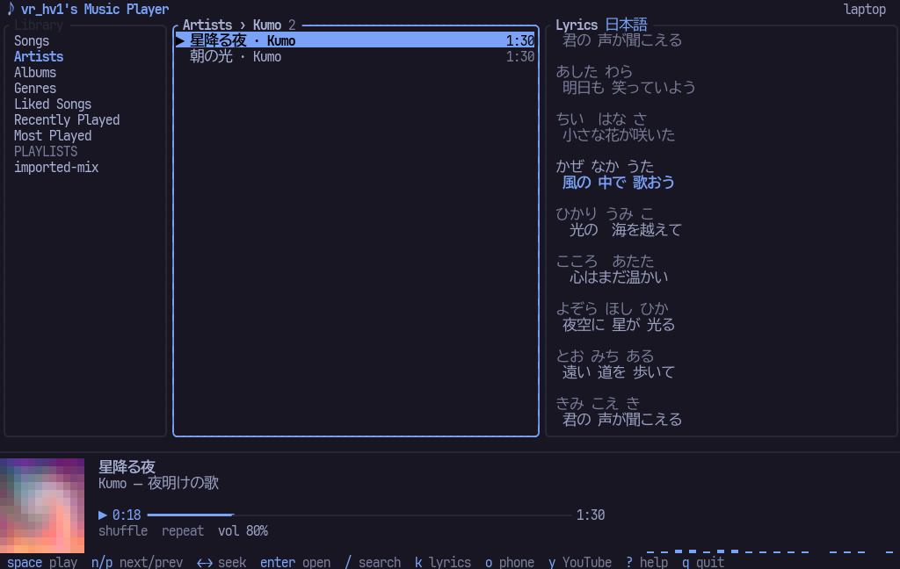
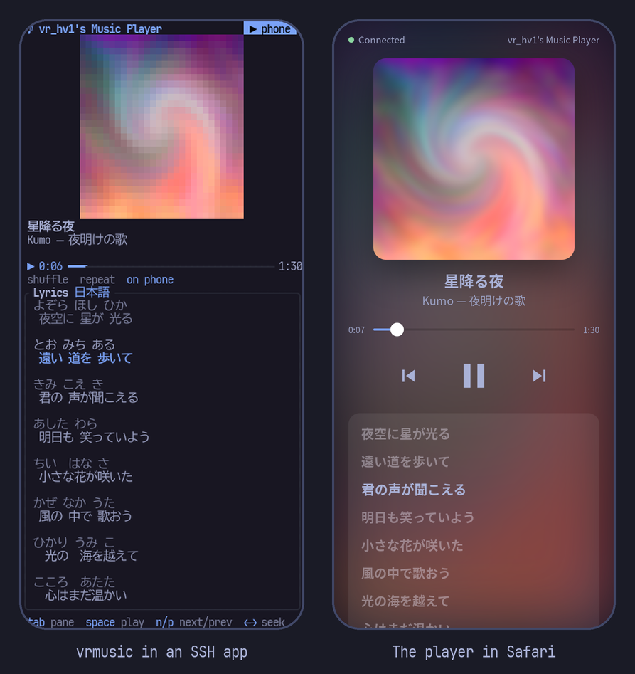

<div align="center">

# vrmusic

**vr_hv1's Music Player, in the terminal: synced lyrics, furigana, YouTube downloads, and music on your phone over SSH.**

[](https://github.com/CodingTort/vr_hv1-music-player-TUI-VERSION/releases/latest)
[](#install)
[](#source-and-license)



</div>

`vrmusic` is the terminal edition of [vr_hv1's Music Player](https://github.com/CodingTort/vr_hv1-music-client).
It plays your local music library with synced lyrics, works over SSH, and can send the music to your phone
so you listen there while the terminal is the remote control.

## Contents

- [What it does](#what-it-does)
- [Install](#install)
- [Start](#start)
- [Listen on your iPhone](#listen-on-your-iphone)
- [Keys](#keys)
- [Troubleshooting](#troubleshooting)
- [Settings and data](#settings-and-data)
- [Privacy](#privacy)
- [Source and license](#source-and-license)

## What it does

- **Your library**: songs, artists, albums, genres, liked songs, recently and most played, playlists, search.
- **Synced lyrics**: the line being sung lights up; scroll freely, and they follow the song again 10 seconds after
  you stop. Fix a song's timing with `[` / `]` or by syncing a line.
- **Japanese**: furigana above the kanji and a Japanese ⇄ romaji switch, both with grammar-aware readings (MeCab).
- **YouTube**: search and download songs straight into your library.
- **Playlists**: create, add, remove, rename, delete; share them as tiny CSV files of YouTube IDs.
- **Album art** drawn in the terminal, a visualiser, your colour theme, mouse and touch support.
- **Phone-friendly**: on a narrow screen it shows one pane at a time, and `t` gives a big now-playing view.
- **Listen on your phone**: press `o` and the music plays in your phone's browser, with lyrics and lock-screen controls.

## Install

**Download** (x86_64, up-to-date Arch Linux or Arch-based; needs glibc 2.43+ and `alsa-lib`): get
`vrmusic-…-x86_64-linux.tar.gz` from the [latest release](https://github.com/CodingTort/vr_hv1-music-player-TUI-VERSION/releases/latest), then:

```bash
tar xzf vrmusic-*-x86_64-linux.tar.gz
cd vrmusic-*-x86_64-linux
./install.sh                 # installs vrmusic and vrmusic-tui to ~/.local/bin
```

`./install.sh --uninstall` removes them. Make sure `~/.local/bin` is on your `PATH`.

**From source** (any Linux, Rust 1.89+): the code lives in the main repository, and `make install` there
installs the terminal player together with the desktop app.

```bash
git clone https://github.com/CodingTort/vr_hv1-music-client.git
cd vr_hv1-music-client
make install
```

**Optional extras**

| For | Install (Arch) |
|---|---|
| Keeping the player running when SSH disconnects | `tmux` |
| Listening on your phone without an SSH tunnel | `tailscale` (and the Tailscale app on the phone) |
| YouTube search and download | `yt-dlp ffmpeg` |
| Online lyrics | `curl` |
| Furigana and romaji | `kakasi`, plus `mecab-git mecab-ipadic` from the AUR for accurate readings |
| Japanese text in the terminal | a terminal font with Japanese characters, e.g. `noto-fonts-cjk` |

The main README lists [every dependency](https://github.com/CodingTort/vr_hv1-music-client#requirements)
with Debian/Ubuntu and Fedora package names.

## Start

```bash
vrmusic
```

It opens the player inside a tmux session called `music` (or goes back to it if it's already running), so
the music keeps playing when your SSH connection drops; run `vrmusic` again to get back to it. Without tmux
installed it just runs the player. `vrmusic --phone` starts with the music on your phone.

Your music is read from `~/Music`. Press `?` for all keys.

## Listen on your iPhone

<p align="center"></p>

1. **Once:** install [Tailscale](https://tailscale.com/download) on the computer and the iPhone, signed in to the same
   account, and an SSH app on the iPhone (e.g. Termius or Blink Shell).
2. **SSH** into the computer from the iPhone, using its Tailscale name.
3. Run **`vrmusic`** and press **`o`**. It shows a short address (like `http://my-laptop:8337`) and a 6-digit code.
4. Open the address in **Safari**, type the code, and tap **Connect**. Tap **▶** once to start the sound
   (iPhones don't start sound on their own).
5. Tap **Share › Add to Home Screen**: next time, open it from there, no code needed.

The page keeps the line being sung in the middle of the lyrics; scroll them freely, and they return to it
10 seconds after you stop. The terminal stays the remote: play, pause, skip and search there, or use the
buttons on the page and on the lock screen. Songs keep moving on with the phone locked. Press `o` again to bring the music back to
the computer at the same spot.

**Without Tailscale**, use an SSH tunnel: connect with `ssh -L 8337:127.0.0.1:8337 you@computer` (in
Termius: *Port Forwarding*, local, 8337 → 127.0.0.1:8337), then open `http://localhost:8337`. iOS closes the
tunnel soon after you leave the SSH app, so Tailscale works better on an iPhone.

## Keys

| Key | Action | | Key | Action |
|---|---|---|---|---|
| `Space` | play / pause | | `k` | lyrics pane |
| `n` / `p` | next / previous | | `j` | Japanese ⇄ romaji |
| `←` / `→` | seek (`Shift`: 30 s) | | `g` | furigana on / off |
| `+` / `-` | volume | | `[` / `]`, `0` | lyrics earlier / later, reset |
| `s` / `r` | shuffle / repeat this song | | `S` | sync the selected lyric line to now |
| `Enter` | play / open artist, album… | | `c` / `a` / `d` | new playlist / add / remove song |
| `Esc` / `⌫` | back, clear search | | `R` / `D` | rename / delete playlist |
| `/` | search | | `x` / `i` | export / import playlist (CSV) |
| `Tab`, `1` `2` `3` | switch pane | | `y` | YouTube search and download |
| `t` | now-playing view | | `o` / `O` | music on your phone ⇄ here / show the phone code |
| `l` | like | | `e` | edit tags |
| `v` | visualiser | | `,` | settings |
| `F5` | rescan library | | `q` | quit |

Mouse and touch: tap to select, double-tap to play, scroll, tap the progress bar to seek, tap a lyric line
to jump to it.

## Troubleshooting

| What you see | What to do |
|---|---|
| Safari can't find the address | Use the number address the dialog shows under the name (`100.x.y.z`), or check Tailscale is on in the phone. |
| "That code has expired" | Press `O` (capital) in the terminal for a new code. Codes last 10 minutes and allow 5 tries. |
| "This needs the player's key" | You opened an old link: open the short address and enter the code instead. |
| The page says "Playing on the computer" | Press `o` in the terminal to move the music to the phone. |
| No sound on the phone | Tap ▶ on the page once, and turn up the phone's volume while the page is playing. |
| The terminal froze after switching apps | iOS suspended the SSH app. Reconnect and run `vrmusic`: the player was still running in tmux. |
| Strange characters instead of Japanese | Use a terminal font that includes Japanese characters. |
| The album art looks like coloured blocks | Your terminal lacks 24-bit colour; most terminals (and Termius, Blink) have it. |

## Settings and data

`vrmusic` shares its library, playlists, likes, lyric timing fixes and settings with the desktop app in
`~/.config/lavanda/`. Run one of the two at a time. Press `,` for the theme, visualiser style and online
lyrics; everything else is in `~/.config/lavanda/config.toml` (`phone_port` sets the phone player's port).

## Privacy

Lyrics are looked up on lrclib.net (title, artist and length of the playing song; turn it off in
settings), and YouTube searches go to YouTube. The phone player only listens on the computer itself and on
its Tailscale address, and only lets in a phone that entered the code shown in your terminal.

## Source and license

The source code is in [vr_hv1-music-client](https://github.com/CodingTort/vr_hv1-music-client) (`src/tui/`),
under the MIT license; it builds on [lavanda](https://github.com/sheep-farm/lavanda) by Flavio de Vasconcellos.
Report bugs and ideas in [its issues](https://github.com/CodingTort/vr_hv1-music-client/issues).
